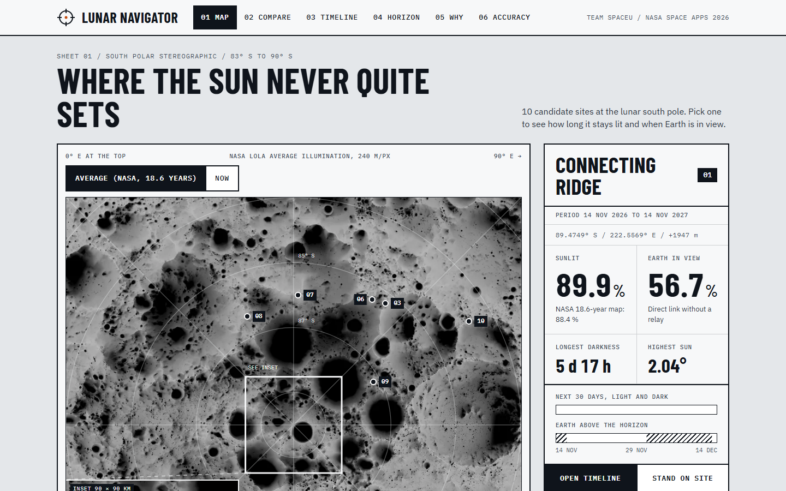

# SpaceU Lunar Navigator

NASA Space Apps Challenge 2026, challenge **Lunar Landing Site Navigator**. Team **SpaceU** (Kyiv).

A web tool that compares landing sites and dates at the lunar south pole by two things a mission cannot do without: **sunlight** (power) and **a view of Earth** (direct communication). Pick sites and a period, and see how much of the time each site is lit, how long the longest darkness lasts, when Earth is visible, and how many hours remain until the next sunset and Earthset, with the real mountains on the horizon taken into account.

**Live site:** https://evge14n.github.io/spaceu-lunar-navigator/ · **Demo, 7 slides (PDF):** https://evge14n.github.io/spaceu-lunar-navigator/slides/demo.pdf



Sheets: 00 Globe (the whole Moon from a compressed LRO model with the ten sites on it; pick a site and open the view from the ground), 01 Map, 02 Compare, 03 Timeline, 04 Horizon (3D), 05 Why, 06 Accuracy.

## How to run

```bash
cd frontend
npm install
npm run dev
```

Then open the printed link (for example http://localhost:5173/spaceu-lunar-navigator/). The site reads precomputed JSON, so no server is needed; the Python backend is described in [backend/README.md](backend/README.md).

## What is inside

| Folder | What | Owner |
|---|---|---|
| `backend/` | Python: Sun and Earth positions (NAIF SPICE), horizon masks from LOLA terrain, metrics, FastAPI | Yevhen Martynyuk |
| `data/` | site list, precomputed JSON for the demo, terrain tiles for 3D | Yevhen Martynyuk |
| `frontend/` | React app: globe, map, comparison table, timeline chart, 3D view, explanations | Anastasiia Usenko, Anastasiia Shestopal |
| `docs/` | architecture, API contract, validation, task plan | everyone |

Start with [docs/ARCHITECTURE.md](docs/ARCHITECTURE.md), the API contract is in [docs/API.md](docs/API.md), the plan for the weekend is in [docs/TASKS.md](docs/TASKS.md) (in Ukrainian).

## Team

Yevhen Martynyuk, Anastasiia Shestopal, Nazar Cherniak, Anastasiia Usenko.

Commits come from Yevhen Martynyuk (GitHub Evge14n) and Anastasiia Shestopal (GitHub Lavina29); some of Anastasiia's commits carry the git name 'Mykola Shestopal'.

## NASA data

- NAIF SPICE generic kernels (NASA/JPL): `naif0012.tls`, `de440s.bsp`, `moon_pa_de440_200625.bpc`, `moon_de440_250416.tf`, `pck00011.tpc`.
- LOLA polar elevation models, LRO (PDS Geosciences Node): `ldem_85s_20m`, `ldem_80s_80m`, `ldem_75s_120m`, and `ldem_75s_60m` for validation.
- LOLA 5 m/pixel site models (NASA PGDA; Barker et al. 2021, https://doi.org/10.1016/j.pss.2020.105119).
- LOLA illumination maps (NASA PGDA; Mazarico et al. 2011, https://doi.org/10.1016/j.icarus.2010.10.030), used as a map layer and for validation.
- JPL Horizons API, used as a reference in tests and for the Sun and Earth elevations quoted on the Why sheet.
- NASA Moon Fact Sheet (NSSDCA, https://nssdc.gsfc.nasa.gov/planetary/factsheet/moonfact.html), basic facts quoted on the Why sheet.

## Use of AI

Claude helped with the code.

## License

Apache-2.0.
